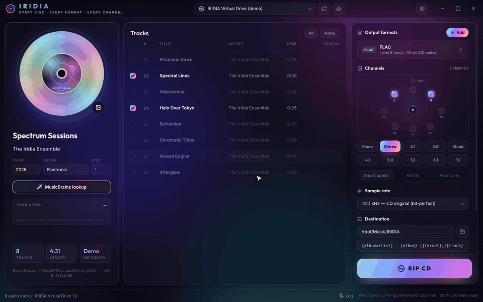
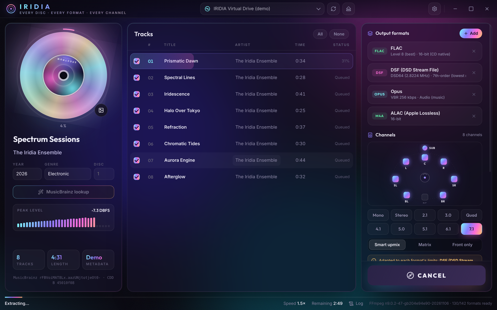
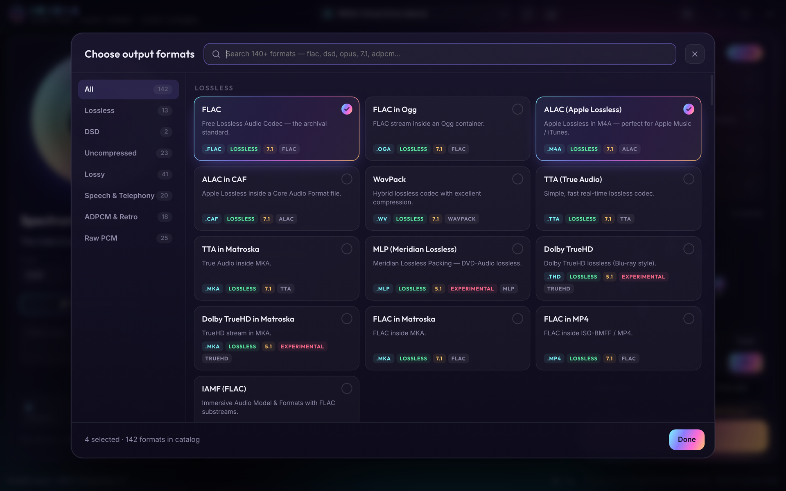
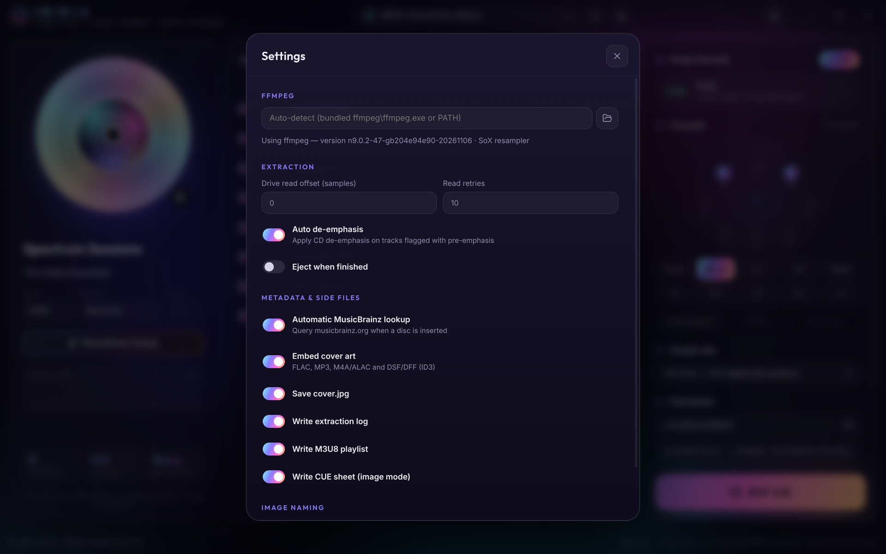

<div align="center">


# IRIDIA

**Portable CD ripper for Windows that exports to every FFmpeg 9.0.2 audio format and to native DSD, in layouts up to 7.1.**

[](../../releases)




</div>

## Overview

IRIDIA reads an audio CD once and encodes every selected output format in parallel. Supported outputs:

- all 89 audio encoders of FFmpeg 9.0.2
- native DSF and DFF, written by a built-in 1-bit DSD engine

The CD's stereo can be upmixed to any layout from mono to 7.1. The application is fully portable: extract it and run it, with no installation.

## Features

- **142 output presets.** They cover:
  - lossless formats: FLAC, ALAC, WavPack, TTA, MLP, TrueHD
  - uncompressed formats: WAV, RF64, W64, AIFF, CAF, plus every raw PCM type
  - lossy formats: MP3, AAC, Opus, Vorbis, AC-3, E-AC-3, DTS, MP2, WMA, LC3, aptX, SBC
  - speech codecs: AMR, G.711, G.722, G.723.1, G.726, GSM, iLBC, Codec 2, Speex
  - all ADPCM variants and IAMF
- **Parallel engine.**
  - The drive is read continuously while finished tracks are encoded.
  - Every output format of every track is encoded at the same time, across all CPU cores.
  - The drive is switched to its maximum read speed.
- **Native DSD.** DSF and DFF output from DSD64 to DSD512, using a 5th- or 7th-order sigma-delta modulator with ID3 tags and cover art. Each channel is modulated on its own CPU core.
- **Surround up to 7.1.** You can choose:
  - ten channel layouts
  - three upmix modes: Smart (FFmpeg `surround` filter with LFE extraction), Matrix, and Front only (bit-transparent)
- **Automatic adaptation.** Each format is limited to the channel count and sample rate it supports, and IRIDIA tells you when this happens.
- **Resampling.** Output from 8 kHz to 384 kHz via the SoX resampler; 44.1 kHz stays bit-perfect.
- **Native Windows CD access.** Includes:
  - raw CDDA reads, TOC and CD-Text
  - secure mode (dual read and compare)
  - drive read-offset correction
  - automatic de-emphasis
- **Metadata.** MusicBrainz lookup and Cover Art Archive artwork, with CD-Text as a fallback.
- **Output files.**
  - naming templates
  - embedded cover art
  - an extraction log with CRC32 checksums
  - M3U8 playlists
  - optional single-file image with a CUE sheet

## Screenshots

| Main window | Format browser |
|---|---|
|  |  |

<p align="center"></p>

## Installation

1. Download `IRIDIA-1.0.0-portable-win64.rar` from [Releases](../../releases).
2. Extract it to any folder.
3. Run `IRIDIA.exe`.

The FFmpeg 9.0.2 full build ([gyan.dev](https://www.gyan.dev/ffmpeg/builds/)) is included in the `ffmpeg` folder. Settings are stored in `IRIDIA-data` next to the executable.

**Requirements:**

- Windows 10 or 11, 64-bit
- an optical drive that can read audio CDs
- about 550 MB of disk space

## Usage

1. Insert an audio CD. The track list and metadata load automatically.
2. Review the album and track information. You can also change the cover art.
3. Click **Add** to choose one or more output formats. Expand a format to adjust its options.
4. Select a channel layout, an upmix mode and a sample rate.
5. Choose the destination folder and press **Rip CD**.

**Naming tokens:** `{albumartist}` `{artist}` `{album}` `{title}` `{track}` `{year}` `{genre}` `{disc}` `{format}`

**Performance:** encoding uses every CPU thread by default. You can limit this under *Settings > Performance*. With standard formats, the CD drive's read speed is usually the limit. *Secure mode* reads every block twice, so it halves the read speed.

**Drive offset:** for accurate rips, set your drive's read offset under *Settings > Extraction*. Values are listed in the [AccurateRip drive database](http://www.accuraterip.com/driveoffsets.htm).

## Format limits

| Format | Maximum layout | Notes |
|---|---|---|
| FLAC, WavPack, TTA, WAV, AIFF, Opus, Vorbis, AAC | 7.1 | |
| DFF (DSDIFF) | 7.1 | DSD64 to DSD512 |
| DSF | 5.1 | Limited by the DSF specification |
| AC-3, E-AC-3, DTS, MLP, TrueHD | 5.1 | |
| MP3, MP2, WMA, LC3, SBC, aptX | Stereo | |
| Telephony codecs (AMR, G.7xx, GSM, iLBC, Codec 2) | Mono | Fixed sample rates |

When a format can't support the requested layout or sample rate, IRIDIA uses the closest one it does support.

## Building from source

```bash
git clone https://github.com/realauthorfilms/iridia.git
cd iridia
npm install
npm start                 # development
IRIDIA_DEMO=1 npm start   # virtual disc, no drive required
```

To build the portable Windows package (requires `rar`, and `wine` to set the executable icon):

```bash
FFDIR=/path/to/ffmpeg-9.0.2-full_build ./tools/build-win.sh
```

Test suites:

| Command | What it tests |
|---|---|
| `node tools/test_catalog.js '' --all-opts` | Every preset and option, encoded with the bundled `ffmpeg.exe` |
| `node tools/test_dsd.js` | DSF/DFF encoding and decoding |
| `node tools/test_rip.js` | The full rip pipeline, using the virtual disc |

## Known limitations

- The ripper runs on Windows only. The interface also runs on Linux, but without CD access.
- Not yet tested on a physical drive: CD reading follows the Windows API specs and the pipeline was checked on the virtual disc.
- Surround output is derived from the CD's stereo. It is not a discrete multichannel master.
- Encoding runs on the CPU. FFmpeg's audio encoders don't support GPU acceleration: NVENC, Quick Sync and AMF are video-only. The DSD modulator is a sequential feedback loop, and splitting it into parallel blocks for a GPU was tested and degraded the noise shaping, so it uses one CPU core per channel instead.
- High DSD rates (DSD256/512) in 7.1 are CPU-intensive.
- The three Windows Media Foundation presets (`aac_mf`, `mp3_mf`, `ac3_mf`) haven't been tested yet.

## License

IRIDIA is licensed under the [GNU GPL v3.0 or later](LICENSE).

The portable release bundles third-party components under their own licenses:

| Component | License |
|---|---|
| FFmpeg 9.0.2, gyan.dev build | GPLv3 |
| Inter and Outfit fonts | SIL OFL 1.1 |
| Lucide icons | ISC |
| Electron | MIT |
| koffi | MIT |

Metadata is provided by [MusicBrainz](https://musicbrainz.org) and the [Cover Art Archive](https://coverartarchive.org).
