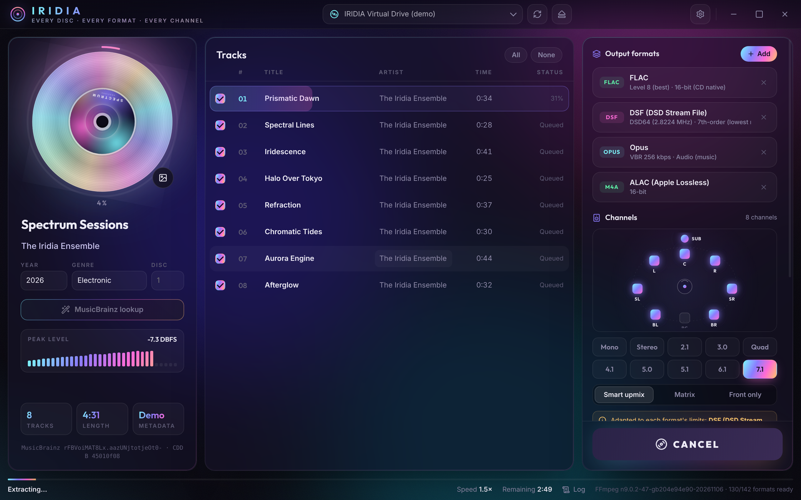

# 🌈 IRIDIA 1.0.0: "First Light"

**Every disc. Every format. Every channel.**

This is the first public release of IRIDIA, a CD ripper for Windows. It turns your audio CDs into **any audio format FFmpeg 9.0.2 can write**, plus **native DSD (DSF/DFF)**, in layouts **from mono up to 7.1 surround**. It's portable: no installation, just extract and run.

## ⬇️ Download

| File | Description |
|---|---|
| `IRIDIA-1.0.0-portable-win64.rar` | Portable Windows 10/11 x64 build, with FFmpeg 9.0.2 (full build) included |

Extract the archive anywhere and launch **`IRIDIA.exe`**.

## ✨ What's in 1.0

### 🎧 142 output presets
- **All 89 audio encoders of FFmpeg 9.0.2**, each paired with the containers that suit it:
  - lossless: FLAC, ALAC, WavPack, TTA, MLP, TrueHD
  - uncompressed: WAV, RF64, W64, AIFF, CAF, plus 25 raw PCM types
  - lossy: MP3, AAC, Opus, Vorbis, AC-3, E-AC-3, DTS, MP2, WMA, LC3, aptX, SBC
  - speech: AMR, G.7xx, GSM, iLBC, Codec 2, Speex
  - every ADPCM / retro game format
  - IAMF immersive audio
- **Native DSD encoder:** **DSF** and **DFF**, from DSD64 to **DSD512**, with a 5th- or 7th-order ΣΔ modulator (≈121 dB in-band SNR at full scale, DSD64, 7th order), one CPU core per channel, ID3 tags and cover art included.
- **Several formats in one pass:** the disc is read once and every format is encoded in parallel.

### 🔊 Surround up to 7.1
- 10 layouts: Mono, Stereo, 2.1, 3.0, Quad, 4.1, 5.0, 5.1, 6.1 and 7.1, shown on an animated speaker map.
- 3 upmix modes: **Smart** (FFmpeg `surround` filter with LFE), **Matrix**, and **Front only** (bit-transparent).
- Each format is adapted automatically to its own limits (channels and sample rate), and IRIDIA tells you when it does.
- Sample rates from 8 kHz to 384 kHz via the SoX resampler. 44.1 kHz stays bit-perfect.

### ⚡ Performance
- A parallel pipeline: the drive keeps reading while finished tracks are encoded. Every track and every format is encoded at the same time, across all CPU cores.
- The drive is asked for its maximum read speed before ripping.
- The DSD engine has been rewritten. It uses one CPU core per channel, a specialised modulator kernel about 2× faster per core, and half the resampling work.
- Measured on a 2-core test machine, for a 4:31 album as 5.1 FLAC + AC-3 + DSF: **121 s → 55 s**. The gain is larger on machines with more cores.
- Encoding runs on the CPU. FFmpeg's audio encoders don't support GPU acceleration, and the DSD modulator can't be split for a GPU without hurting quality.

### 💿 Ripping
- Native Windows CD access: raw CDDA reads, TOC, **CD-Text**, drive model detection, tray eject.
- Optional **secure mode** (every block read twice and compared, at half speed), read retries, sector-level recovery.
- **Drive read-offset correction** and automatic **de-emphasis** for pre-emphasised discs.
- **MusicBrainz** lookup (disc ID plus fuzzy TOC fallback), a picker when several releases match, and **Cover Art Archive** artwork.

### 🗂️ Output
- Naming templates with tokens (`{albumartist}`, `{album}`, `{track}`, `{title}`, `{format}`…).
- Embedded cover art (FLAC, MP3, M4A/ALAC, DSF/DFF) and `cover.jpg`.
- An EAC-style extraction log with peak levels and CRC32 checksums.
- M3U8 playlists, and an optional **single-file image + CUE sheet**.

### 🎨 Interface
- Dark glass design with an iridescent CD that spins while ripping, a progress ring, a live peak meter, and a searchable format browser.
- Inline metadata editing and per-format option panels.
- Portable settings, stored in `IRIDIA-data\` next to the exe.

## ✅ Quality assurance
- Every preset and every option value was test-encoded with the bundled **Windows FFmpeg 9.0.2** build.
- All 10 layouts × 3 upmix modes were swept with the FFmpeg 9.0.2 Linux build: **3,840 encodes, 0 failures**.
- DSF/DFF output is verified by decoding it with FFmpeg and checking it with an independent bit-level decoder.
- The MusicBrainz disc ID matches the libdiscid reference vector.

## ⚠️ Known limitations
- Windows only for this release. The UI runs on Linux, but CD access is Windows-only.
- **Not yet tested on a physical CD drive.** The CD-reading code is written to the Windows API specs and the rip pipeline was checked on a virtual disc. Please report any drive problems.
- **The Media Foundation presets (AAC/MP3/AC-3 `_mf`) haven't been tested yet.** They use encoders that come with Windows, and the release testing ran on Linux.
- DSF is limited to 5.1 by its specification; use DFF for 7.1 DSD. DSD256/512 in 7.1 is CPU-heavy and can run slower than real time.
- Secure mode compares repeated reads. Some drives cache audio data, which makes this less effective. AccurateRip verification is planned.
- Upmixed surround is derived from stereo. It is not a discrete multichannel master.

## 📜 Licenses
IRIDIA is released under GPL-3.0-or-later. It bundles the FFmpeg 9.0.2 full build by gyan.dev (GPLv3), the Inter and Outfit fonts (OFL), Lucide icons (ISC), Electron, and koffi.

---
*Thank you for trying IRIDIA. Bug reports and format requests are welcome in Issues!* 💿✨
